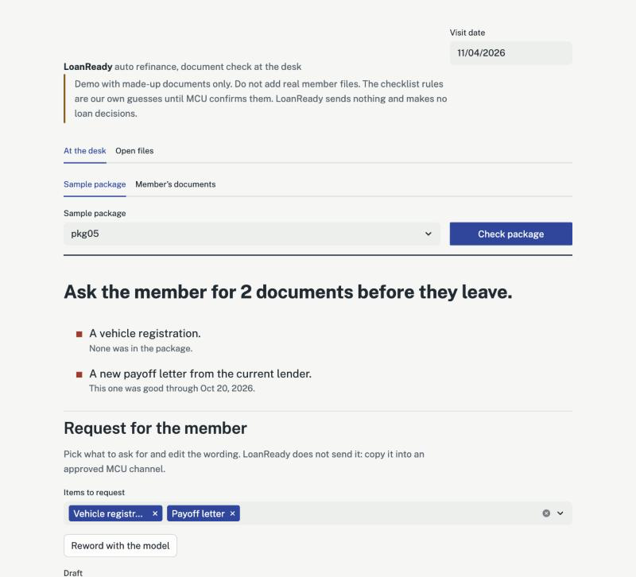
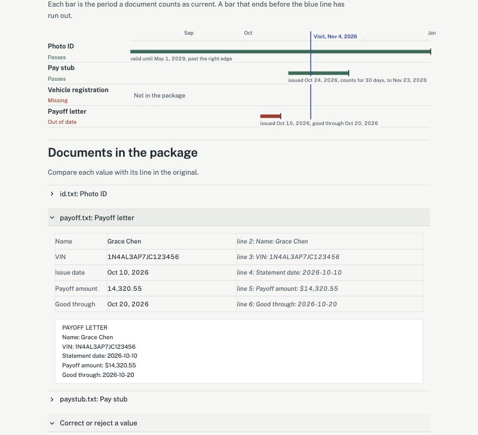

# LoanReady

LoanReady helps a credit union rep catch missing, expired, or out-of-date auto-refinance documents while the member is still at the desk. Each flag says what it is based on, such as the date a letter was good through, and every extracted value is shown beside the document line it came from, so the rep can check before asking the member for anything.

The AI never sees member information, never decides anything, and never sends anything. Under the hood it runs as a small set of agents on a shared loop with built-in rule planners. With an API key set, the screen can use Claude to reword the follow-up draft. Claude planners that pick each agent's next step are built and tested, but the screen does not use them yet. Every checklist decision is plain code, the model never sees member details or document text, and nothing is ever sent.



*The At the desk screen on synthetic package pkg05, with the visit date set to Nov 4, 2026. All names, dates and VINs are made up. An API key was set, which adds the Reword with the model button.*



*Further down the same screen: each document's valid period against the visit date, and every value from the payoff letter beside the line it came from.*

## The problem

We built LoanReady for a public job posting: Member Service Representative (MSR) at Municipal Credit Union (MCU). MCU is not involved in this project. The job description (JD) lists three priorities: accurate first-time documentation, loan pipeline follow-ups, and a 95%+ QA target.

An auto refinance needs several documents, each with its own date rule. If one is missing, expired, or out of date and nobody notices during the visit, it shows up after the member has left, and the rep has to follow up. We have no MCU data on how often that happens, so this README makes no claims about frequency or cost.

LoanReady is a staff-facing tool for that moment. A rep uploads the application documents. LoanReady checks them against a checklist, flags missing, expired, or stale items with the reason for each, and keeps a simple list of open files and follow-ups. "Stale" means present but too old, like a payoff letter past its good-through date. The rep verifies every result and sends every message. LoanReady makes no loan decisions.

Pursuit L2 Cycle 4 project by Ibtisam Hossain (build) and Priscilla Batroni (research, including the review of MCU's auto-refinance checklist).

## What it does for the rep

- **Shows what to ask for before the member leaves.** One check lists every missing, expired, or stale document, with a plain reason for each, such as "This one was good through Oct 20, 2026."
- **Lets the rep check every flag against the original.** The rep can correct or reject a value; the checklist reruns and the source stays visible.
- **Catches names and VINs that don't match.** It compares the name and VIN across documents, so a payoff letter for a different vehicle gets flagged even when every date passes.
- **Keeps open files from going quiet.** The Open files tab rechecks each file against today's date, calls out documents that went stale after the visit, and suggests a next step and follow-up date. The rep decides and saves it.
- **Drafts the request, and the rep sends it.** It writes an editable request for the items the rep selects and checks the wording in code. LoanReady never sends anything.

## Built with

- **Python 3.9**, with the agent loop, checklist rules and field checks in plain Python (`loanready/`)
- **Streamlit 1.50** for the rep screen (`app.py`)
- **Anthropic API** through the `anthropic` Python SDK (0.125), calling the model set in `MODEL_ID` (`claude-sonnet-5-5` in `.env.example`) with JSON-schema structured output. It is optional. On the screen it only rewords the follow-up draft; the Claude planners are built and tested but not connected to the screen yet.
- **SQLite** (Python's built-in `sqlite3`) for saved checks, open files and the rep's corrections, stored locally
- **python-dotenv** to load the API key from a local `.env`
- **pytest** for 133 tests, plus `scripts/eval.py`, an end-to-end eval over 27 synthetic packages

## Try it

For developers. No API key is needed. From the repo root, on Python 3.9:

```
python3 -m venv .venv
.venv/bin/python -m pip install -r requirements.txt -r requirements-dev.txt
.venv/bin/python -m streamlit run app.py
```

Pick a sample package and click Check package. To reproduce the labeled results, set Visit date to Nov 4, 2026, the date the samples are labeled for. The screen opens with what to ask the member for, then an editable request draft, then a date ruler showing each document's valid period against the visit, then every extracted field beside its source line. The Open files tab lists every checked package that has not been closed (up to 100), and `.venv/bin/python scripts/seed_open_files.py` adds five samples. Use synthetic documents only.

## Status

These checks show the tool behaves as designed; they don't show how accurate it would be on real MCU files. Verified November 10, 2026 on Python 3.9.6, on the `checklist/mcu-insurance-title` branch: 133 tests passed and 27/27 synthetic packages matched their labels, using the built-in rules with no AI key. These numbers check that the loop behaves as designed, not real-world accuracy, because the rules and the labels were written together. The JD's 95%+ QA target has not been measured yet: it needs field-level labels written by someone other than the person who wrote the rules. One live run on Claude was done by hand and has no saved log (see Running the checks).

Built: stories 1 to 4 (listed below) on the local demo screen. That covers flags with their reasons, fields beside their source lines, correcting or rejecting a value, the open-file list, and editable follow-up drafts.

Not built: PDFs and photos, marking a requested document as received, the checklist-maintenance screen, and the pay stub and photo ID changes from the research below.

## What the research found

Priscilla Batroni reviewed MCU's real auto-refinance requirements on November 10, 2026:

- MCU's checklist asks for two documents LoanReady did not check: an insurance card, and a NY Certificate of Title for NY vehicles.
- MCU's checklist does not list the pay stub or photo ID that LoanReady requires.
- MCU calls the payoff document a "10-Day Payoff Letter".
- The income and ID questions are still being confirmed, from MCU's refinance application and by calling MCU.

On the `checklist/mcu-insurance-title` branch, the insurance card and the certificate of title are now in the checklist. Their date and scope rules are guesses (see Assumptions in the code). The pay stub and photo ID rules are unchanged until the income and ID questions are answered. The checklist in `loanready/checklist.py` is still marked `CONFIRMED = False`.

## User stories

1. As an MCU Member Service Representative, I need to see which required auto-refinance documents are missing, expired, or stale while the member is at my desk, so that I can ask for them before the member leaves.
2. As an MSR, I need to see each extracted field beside its source line and correct or reject it, so that the file is right the first time.
3. As an MSR, I need a list of open applications with status, last activity, and next follow-up date, so that no file sits without a next action.
4. As an MSR, I need an editable follow-up draft built from the missing items I select, so that I can send a correct request through an approved MCU channel.
5. (Assumption) As an MCU QA reviewer, I need to maintain the checklist and freshness rules, so that reps check against current requirements.

Sources and demo tests for each story are in [docs/user-stories.md](docs/user-stories.md).

## Docs

- [User stories](docs/user-stories.md), each traced to the JD or the product requirements document (PRD)
- [UI handoff](docs/ui-handoff.md): layout and design tokens for the rep screen
- [Build log, Nov 4](docs/build-time-2026-11-04.md): a dated snapshot of one build session, kept for history

## Setup details

The full test suite needs both requirement files. With only `requirements-dev.txt`, the model and screen tests are skipped. The runtime libraries are pinned to the versions the results above were verified with; pytest is a version range.

Offline mode needs no key. For the optional model features, put `ANTHROPIC_API_KEY` and `MODEL_ID=claude-sonnet-5-5` in a local `.env` (see `.env.example`). `.env` is in `.gitignore` and must never be committed. Run `.venv/bin/python test_model.py` to check the key and model; it makes one small API call. The screen's Reword button and `agent.make_planner()` load `.env` themselves. The field-check and open-files model planners expect the variables to already be set in the environment, and nothing in the app or scripts calls them yet.

## Scope

In scope for the MVP: one loan type (auto refinance), synthetic documents only, document classification and field extraction, plain-code checklist rules, an open-application list, and editable follow-up drafts.

Out of scope: loan decisions, credit underwriting or credit reports, real member data, automated messaging, and MCU system integrations.

## Build order

Story 1 (catch missing, expired, or stale documents during the visit) is built first. It is the core of the problem in the PRD and the JD's "accurate first-time documentation" goal, and stories 3 and 4 both depend on its output: the open-file list needs each file's status, and the follow-up draft is built from the missing items. Story 2 (fields beside their source line) comes with it, because a flag the rep can't check against the original isn't useful.

## Assumptions in the code

These are working guesses so the build can move. The research above already contradicts some of them, and each one gets replaced when MCU confirms the real answer.

- The required documents are photo ID, pay stub, vehicle registration, a payoff letter from the current lender, an insurance card, and a NY Certificate of Title. MCU's real checklist differs on the pay stub and photo ID (see What the research found).
- The insurance card must be unexpired on the day of the check, like the photo ID. This is a guess: the research does not say how current it must be. A card with no readable expiry date is flagged "unreadable".
- Every package needs a certificate of title, and having one is enough (no date rule). This is a guess: MCU's checklist asks for it for NY vehicles, but the synthetic registrations record no state, so LoanReady cannot tell which vehicles are from NY. The title's VIN is compared with the registration and payoff letter, and its name with the other documents.
- The insurance card's name is not compared with the other documents, because the research does not say whose name must be on the policy. This is also a guess.
- A pay stub counts as stale after 30 days from its issue date. MCU's checklist may not require a pay stub at all; this is being confirmed.
- A payoff letter is valid through its printed good-through date, counting that day. MCU calls it a "10-Day Payoff Letter". LoanReady does not enforce any issue-age limit, and whether MCU wants one is still to be confirmed.
- Missing, blank, invalid, ambiguous, or repeated good-through dates require rep review (`unreadable`). No guessed date and no fallback to issue age. The original source line is retained. An issue date in the future or after the good-through date also requires review.
- Photo ID and registration only need to be unexpired on the day of the check.
- A document with no readable date is flagged "unreadable" for the rep to check, never passed.
- The check runs against the date of the visit, so a file that passes today can go stale later.
- Documents arrive as text files in one folder per application. Real uploads (PDFs, photos) are out of scope until the loop is proven.
- These rules live in `loanready/checklist.py` with `CONFIRMED = False` until MCU operations signs off.

## The agents

| Agent | Story | File | What it does | What it may write |
|---|---|---|---|---|
| Review | 1, 2 | `loanready/agent.py` | Reads a package and runs the checklist | Nothing |
| Field check | 2 | `loanready/fieldcheck.py` | Compares names and VINs across documents, finds values it could not read, and gets the lines for the rep | Nothing |
| Open files | 3 | `loanready/pipeline.py` | Rechecks every open file against today and proposes a next step and follow-up date | Nothing |
| Follow-up | 4 | `loanready/followup.py` | Drafts a request for the items the rep selected and checks the wording | An editable draft on screen, never sent |

All four run on the same loop and guards (`loanready/harness.py`): an allow-list of actions, a pass limit set before the loop, repeat detection, and a log of every step. Each has an offline planner, so nothing depends on a key, and the screen and scripts use those offline planners. Running a check saves its result and opens or reopens that file, and uploads are saved to `data/uploads/`. Beyond that, only the rep's actions change saved data: saving a correction, a follow-up date or a note, or closing a file.

The model is limited to two jobs: choosing an agent's next step and wording a follow-up draft. It decides no result.

- **What the model sees.** Planners get only file names, field names, statuses and progress. The follow-up writer gets only document types and what is needed. Member details, document text and extracted values never reach it, and tests check that.
- **Field check.** Comparison is exact apart from spacing and case, so a near match still goes to the rep. If a required value was not read, the agent scans the file for lines with that label. Those lines are hints: they never fill in a value or change a checklist status.
- **Corrections.** A rep's correction or rejection reruns the checklist. The original value and source line stay visible, and the source file is never changed. Corrections are saved and carry over to later checks of the same file.
- **Open files.** A file that passed at the visit can go stale later, so each file is rechecked as of the date on screen, and any status that changed since the last check is called out. A follow-up date is the last activity plus 3 days, or sooner if a document will lapse first. A date the rep sets is kept. This timing is an assumption and a staff reminder only, not a legal deadline.
- **Follow-up drafts.** Plain code checks every draft: it must name exactly the selected documents and contain no decision or credit language, links or numbers. A draft that fails is rewritten once with the reasons, then replaced with fixed wording. No agent has a send action.

## How the review agent works

`loanready/agent.py` runs one review as a loop: observe the package state, pick one next action, run it, check the result, repeat.

- Actions are allow-listed: list documents, read a document, scan a document, run the checklist, finish. Anything else is refused and the run stops.
- The path depends on what the agent finds. After the first checklist run it looks at the flags. If a required document is missing and a file was not recognized, it scans that file in full, and if the file turns out to be the missing type, it runs the checklist again. If a document is unreadable, it scans it and collects lines that look like dates as hints for the rep. Hints never pass a document. If two files have the same type, the checklist flags it for the rep instead of picking one.
- Every pass logs the action, a short reason, and the result, and the demo screen shows them under "How LoanReady checked it".
- Tools are read-only and can only open files inside `data/synthetic/` or `data/uploads/` (`loanready/tools.py`).
- Stop rules: done when every listed document is read and the checklist is current with a result for every required document; a pass limit set before the loop (30, with at most 12 documents per package); or the same action on the same file twice in a row. Finishing with an out-of-date checklist is reported as finishing early, not success.
- Checklist decisions are plain code in `loanready/checklist.py`, never the model. That file is a placeholder until MCU confirms the real document list (`CONFIRMED = False`).
- Every extracted field keeps the source line as evidence, so the rep can compare it to the original.
- The only output is an editable draft marked DRAFT. LoanReady never sends anything.
- Text inside a document is treated as data. Package pkg07 has a planted "ignore the checklist" note, and the agent still flags it. The model planner only sees file names and checklist statuses, never document text, and a test checks that.

The offline `RulePlanner` is used for tests and evals. `ClaudePlanner` asks the model for the next step, and its choice still goes through the same allow-list. It is not connected to the screen or scripts yet; it runs only when called from Python, and `agent.make_planner()` picks it when a key and model are set. A failed or refused model call stops the run with a reason. It does not guess.

## Running the checks

```
.venv/bin/python scripts/eval.py              # end-to-end eval against the labels
.venv/bin/python -m pytest -q tests           # safety and loop tests
.venv/bin/python scripts/make_synthetic.py    # optional: regenerate the committed synthetic packages
```

Uploads go to `data/uploads/` and results to `data/loanready.db`, both ignored by git. The screen's check uses the offline `RulePlanner`. When a key is set, a "Reword with the model" button can word the draft. The screen loads the Public Sans font from Google Fonts; no member data or document text is sent anywhere.

The eval runs 27 synthetic packages: 10 originals, 6 payoff-date regressions (11 to 16), 3 branching cases (17 to 19), 3 field-check cases (20 to 22), and 5 insurance card and title cases (23 to 27). Every package has all six documents unless a case removes one, and every package must pass. Real accuracy needs MCU's checklist and documents labeled by someone else.

The payoff-date cases cover a nine-day-old letter with an expired good-through date, ambiguous and blank dates, an invalid calendar date, validity ending today, and an older letter with an explicit later validity date. Unit tests also cover missing or duplicate dates and inconsistent issue/validity dates.

Packages 17 to 19 make the loop branch: a pay stub hidden under a long letterhead (scanned, recognized, checklist rerun), a pay stub with a date the strict reader skips (stays unreadable, rep gets the line), and two pay stubs in one package (sent to the rep). The eval prints each run's path and how many distinct paths were taken.

Packages 20 to 22 pass the checklist but fail the field check: a payoff letter with another vehicle's VIN, a pay stub in another name, and a VIN one character short. The eval also requires a passing follow-up draft, written by the fixed template, for every package with a checklist flag.

Packages 23 to 27 each change one thing: no insurance card (missing), an insurance card that expired before the visit (expired), an insurance card whose expiry date the strict reader cannot use (unreadable, rep gets the line), no certificate of title (missing), and a title with another vehicle's VIN (passes the checklist, the field check flags the VIN).

One live run on `claude-sonnet-5-5` was done by hand on November 5, 2026, and no log of it is saved in the repo. In that run, the model planners for the review, field check and open-files agents finished on four packages with the same review flags as the offline planner, and the follow-up writer's drafts on two packages passed the check. This does not measure live-model reliability or production accuracy. The 95% field-accuracy metric still needs field-level labels, written by someone other than the person who wrote the rules.

## Safety

- Synthetic data only. Never commit real member data or API keys.
- Read-only tools first; the agent writes drafts only.
- Inputs are validated in code and tools are allow-listed.
- A person approves every correction and every message.
